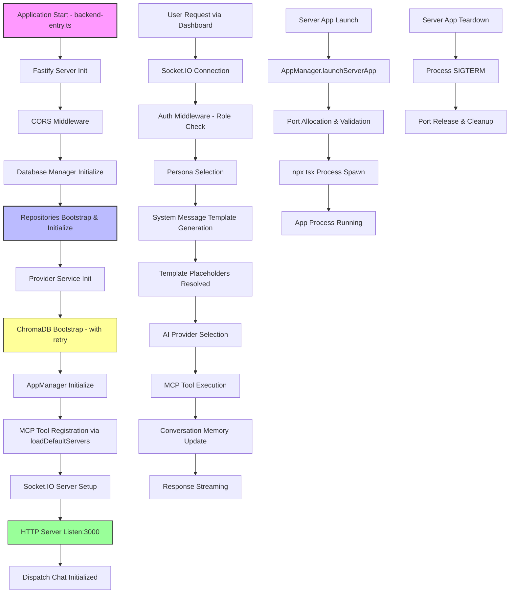

# AGENTS.md - Architect Mode Rules

## Project Architecture Rules (Non-Obvious Only)

### Core Architecture Flow

1. Application starts via `src/backend-entry.ts`
2. Server initializes Fastify on port 3000
3. MCP tools registered in singleton `MCPToolRegistry` during startup
4. `ProviderService` initializes AI providers and ChromaDB
5. Socket.IO connections handle incoming requests
6. `AppManager` manages multiple app instances dynamically

### Database Connection Requirements

- [`src/backend/db/DatabaseManager.ts`](src/backend/db/DatabaseManager.ts): `connect()` → `initialize()` required sequence
- `DatabaseManager.connect()` bootstraps all repositories (`authRepository`, `aiProviderRepository`, `appsRepository`, `personaRepository`, `commandRepository`, `toolsRepository`, `contextSettingsRepository`)
- Each repository has separate `initialize()` method called after all bootstrap
- Per-app databases: `src/apps/{app-id}/db/the_lab.db` (created by `AppDatabaseService`)

### Singleton Pattern

All services use static `getInstance()`:
- `MCPToolRegistry.getInstance()` - Single tool registry singleton
- `AppManager` - Single instance manages all app processes
- `ProviderService` - AI provider orchestration (OpenAI/Ollama)
- `VSCodeLogger` - Central logging service
- `databaseManager` - Primary database access singleton
- `AppDatabaseService` - Per-app database instances (creates isolated DBs)

### Circular Dependencies

- `src/` namespace contains BOTH backend (`src/backend/`) and frontend (`src/apps/`) code
- Backend serves as API for frontend apps
- Frontend apps connect via Socket.IO to backend server
- Backend provides MCP tools for external agents to interact with codebase
- Frontend components (`src/apps/`) and dashboard (`src/dashboard/`) are Vue 3 Single File Components
- TypeScript types in `src/shared/types/` are shared across codebase

### Hidden Dependencies

- MCP tools depend on file operations via [`fileHelpers`](src/backend/utils/file-helpers.ts)
- ProviderService depends on ChromaDB connection for memory
- AppManager requires server logging via `server.log`
- Socket.IO events trigger app route initialization

### Environment-Specific Behavior

- `DATABASE_PATH` overrides default location `data/lab.db` (relative to project root)
- `BACKEND_URL` allows external URL override for frontend
- `VITE_LOGGING_ENABLED` (0 or 1) enables/disables file logging

### Graceful Shutdown ([`src/backend/server.ts`](src/backend/server.ts))

- SIGTERM handler closes BOTH `server.close()` AND `httpServer.close()`
- Must call both handlers: `httpServer` is separate from Fastify `server`
- Logs "Server closed gracefully" on success
- Missing shutdown handling can leave ChromaDB connection in inconsistent state

### App Types ([`src/templates/shared/types/App.ts`](src/templates/shared/types/App.ts))

- **Browser apps**: Pure Vue SFC components rendered in dashboard
- **Server apps**: Node.js processes via `tsx` ([`src/backend/AppManager.ts`](src/backend/AppManager.ts)), listen on dynamic ports 4000-4999
- **Hybrid apps**: Both browser component AND server process

### Port Configuration

- Backend: Fixed port 3000 (never change)
- Server apps: Dynamic ports 4000-4999 via `envConfig.defaultPortOffset`

### MCP Server Architecture ([`src/backend/mcp/`](src/backend/mcp/))

THE-LAB has evolved from internal tools to a full MCP (Model Context Protocol) server architecture with support for both stdio and HTTP transports.

#### Core Components

| Component | File | Purpose |
|-----------|------|---------|
| [`MCPServerLoader`](src/backend/mcp/mcp-server-loader.ts:12) | Singleton per user | Loads and manages external MCP servers |
| [`StdioProvider`](src/backend/mcp/mcp-server-providers/stdio-provider.ts:23) | Stdio transport implementation | Spawns child processes for stdio-based servers |
| [`StreamableHTTPProvider`](src/backend/mcp/mcp-server-providers/streamable-http-provider.ts:8) | HTTP transport implementation | Connects to streamable HTTP MCP servers |
| [`MCPToolRegistry`](src/backend/mcp/mcp-tool.ts:27) | Tool registry singleton | Registers and exposes tools to AI agents |

#### Transport Types Supported

- **`stdio`** - Command-line process spawning (e.g., `npx`, `python`)
- **`streamable-http`** - HTTP-based MCP servers with JSON-RPC over HTTP

#### User-Configurable MCP Servers

The settings now allow users to add custom MCP servers via the [`MCPServerManagement`](src/dashboard/components/settings/MCPServerManagement.vue:74) component.

**Database Schema ([`user_mcp_servers`](src/backend/db/MCPServers/mcp-servers-schema.ts:3)):**
```sql
CREATE TABLE user_mcp_servers (
    id INTEGER PRIMARY KEY AUTOINCREMENT,
    userid INTEGER NOT NULL,
    name TEXT NOT NULL,
    command TEXT,              -- e.g., 'npx', 'python'
    args TEXT,                 -- JSON array of arguments
    url TEXT,                  -- For HTTP transport
    transport TEXT DEFAULT 'stdio',
    timeout INTEGER DEFAULT 30,
    enabled INTEGER DEFAULT 1,
    cwd TEXT,                  -- Working directory
    env TEXT,                  -- Environment variables (JSON)
    headers TEXT,              -- HTTP headers (JSON)
    tools TEXT,                -- Tool definitions (JSON)
    created_at DATETIME,
    updated_at DATETIME
);
```

**Default MCP Servers Seeded:**
| Server | Transport | Tools |
|--------|-----------|-------|
| `datetime` | stdio | 9 datetime utilities |
| `the-lab-db` | stdio | 5 SQLite query tools |

#### Tool Wrapper Pattern

External MCP server tools are wrapped in [`MCPToolInterface`](src/shared/types/mcp-tools.ts) implementations that:
- Parse the external server's `inputSchema` into Zod schemas
- Delegate execution to the transport provider
- Mark as `isExternal: true` for identification

**See:** [`MCPServerLoader.extractAndRegisterTools()`](src/backend/mcp/mcp-server-loader.ts:122)

#### Connection Retry Logic

- **Stdio**: Single attempt with stderr event monitoring
- **HTTP**: Up to 5 attempts with 25% timeout intervals between retries

### MCP Tool Registration ([`src/backend/server.ts`](src/backend/server.ts))

Tool registration now uses the `loadDefaultServers()` method:

```typescript
await mcpRegistry.loadDefaultServers()
```

The `loadDefaultServers()` method in [`MCPToolRegistry`](src/backend/mcp/mcp-tool.ts:110) registers all default MCP servers using the `registerMCPServer()` method which connects to in-memory transport and adapts tools via [`MCPToolAdapter`](src/backend/mcp/utils/mcp-tool-adapter.ts).

Each MCP server is defined in its own module under [`src/backend/mcp/mcp-servers/`](src/backend/mcp/mcp-servers/) and exports both the server instance and tools manifest.

### Adding a New MCP Server Module

1. Create server class in `src/backend/mcp/mcp-servers/{category}/`:
   - Export `mcpServer` instance (McpServer from @modelcontextprotocol/sdk)
   - Export `toolsManifest` array (MCPToolManifest[])
2. Add export to `src/backend/mcp/mcp-servers/index.ts`
3. Register in `loadDefaultServers()` method

### Architecture Flow Diagram



---

*This documentation serves as the primary reference for agents operating within THE-LAB. Always prioritize system safety, user confirmation for destructive actions, and code modification within designated directories only.*
