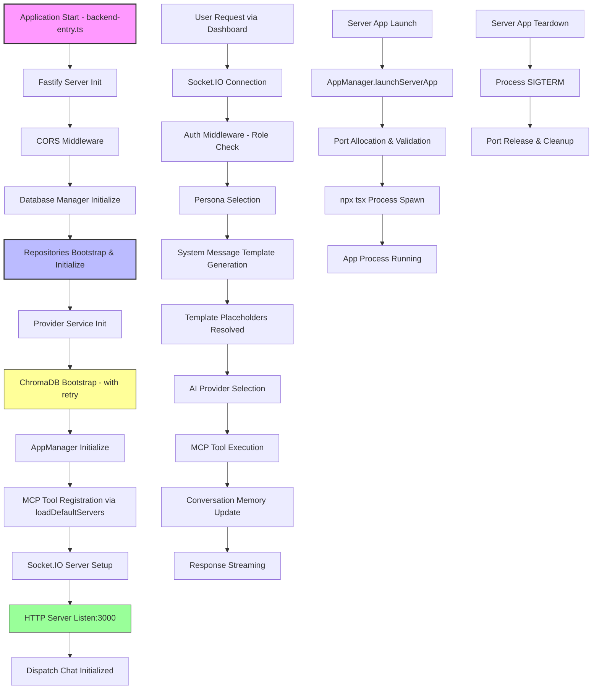

# AGENTS.md - Ask Mode Rules

## Project Asking Rules (Non-Obvious Only)

### Context7 Documentation ([`mcp_context7_resolve_library_id`](src/backend/mcp/mcp-server-loader.ts:12))

When researching library documentation or API references:

1. **Resolve Library ID First**: Use `mcp_context7_resolve_library_id` to obtain the Context7-compatible library ID
   - Query format: Library name (e.g., "Next.js", "Express.js")
   - Returns: Library ID, Name, Description, Code Snippets count, Source Reputation, Benchmark Score, Versions

2. **Query Documentation**: Use `mcp_context7_query_docs` with the resolved library ID
   - Query format: Specific concept within the library (e.g., "authentication with JWT", "file upload")
   - Returns: Documentation content and code examples

3. **Best Practices for Queries**:
   - Be specific about the concept being queried
   - Keep each query focused on a single topic
   - Avoid combining multiple distinct concepts in one query
   - Use library-specific terminology when possible

### MCP Server Architecture ([`src/backend/mcp/`](src/backend/mcp/))

THE-LAB has evolved from internal tools to a full MCP (Model Context Protocol) server architecture with support for both stdio and HTTP transports.

#### Core Components

| Component | File | Purpose |
|-----------|------|---------|
| [`MCPServerLoader`](src/backend/mcp/mcp-server-loader.ts:12) | Singleton per user | Loads and manages external MCP servers |
| [`StdioProvider`](src/backend/mcp/mcp-server-providers/stdio-provider.ts:23) | Stdio transport implementation | Spawns child processes for stdio-based servers |
| [`StreamableHTTPProvider`](src/backend/mcp/mcp-server-providers/streamable-http-provider.ts:8) | HTTP transport implementation | Connects to streamable HTTP MCP servers |
| [`MCPToolRegistry`](src/backend/mcp/mcp-tool.ts:27) | Tool registry singleton | Registers and exposes tools to AI agents |

#### Transport Types Supported

- **`stdio`** - Command-line process spawning (e.g., `npx`, `python`)
- **`streamable-http`** - HTTP-based MCP servers with JSON-RPC over HTTP

#### User-Configurable MCP Servers

The settings now allow users to add custom MCP servers via the [`MCPServerManagement`](src/dashboard/components/settings/MCPServerManagement.vue:74) component.

**Database Schema ([`user_mcp_servers`](src/backend/db/MCPServers/mcp-servers-schema.ts:3)):**
```sql
CREATE TABLE user_mcp_servers (
    id INTEGER PRIMARY KEY AUTOINCREMENT,
    userid INTEGER NOT NULL,
    name TEXT NOT NULL,
    command TEXT,              -- e.g., 'npx', 'python'
    args TEXT,                 -- JSON array of arguments
    url TEXT,                  -- For HTTP transport
    transport TEXT DEFAULT 'stdio',
    timeout INTEGER DEFAULT 30,
    enabled INTEGER DEFAULT 1,
    cwd TEXT,                  -- Working directory
    env TEXT,                  -- Environment variables (JSON)
    headers TEXT,              -- HTTP headers (JSON)
    tools TEXT,                -- Tool definitions (JSON)
    created_at DATETIME,
    updated_at DATETIME
);
```

**Default MCP Servers Seeded:**
| Server | Transport | Tools |
|--------|-----------|-------|
| `datetime` | stdio | 9 datetime utilities |
| `the-lab-db` | stdio | 5 SQLite query tools |

#### Tool Wrapper Pattern

External MCP server tools are wrapped in [`MCPToolInterface`](src/shared/types/mcp-tools.ts) implementations that:
- Parse the external server's `inputSchema` into Zod schemas
- Delegate execution to the transport provider
- Mark as `isExternal: true` for identification

**See:** [`MCPServerLoader.extractAndRegisterTools()`](src/backend/mcp/mcp-server-loader.ts:122)

#### Connection Retry Logic

- **Stdio**: Single attempt with stderr event monitoring
- **HTTP**: Up to 5 attempts with 25% timeout intervals between retries

### SQLite Database Queries ([`mcp_sqlite_read_query`](src/backend/db/DatabaseManager.ts))

When querying the main application database:

1. Use `mcp_sqlite_list_tables` to discover available tables
2. Use `mcp_sqlite_describe_table` to understand table schema
3. Use `mcp_sqlite_read_query` for SELECT queries only
4. For write operations, use `mcp_sqlite_write_query` (INSERT, UPDATE, DELETE)

**Main Database Tables:**
- `users` - User authentication and profiles
- `apps` - App registry and metadata
- `personas` - Persona definitions and tools
- `commands` - Slash command definitions
- `tools` - MCP tool metadata
- `context_settings` - Context and configuration settings
- `user_instructions` - User instruction configurations

**Per-App Database Tables:**
- Located at `src/apps/{app-id}/db/the_lab.db`
- Standard tables: users, items, configs, logs (configurable)

### SQLite Query Best Practices

1. **Always use SELECT for read operations**: Never modify data with read queries
2. **Validate table existence**: Check schema before querying
3. **Use parameterized queries**: Prevent SQL injection
4. **Limit result sets**: Use LIMIT clause for large datasets
5. **Handle NULL values**: Check for NULL in WHERE clauses

### SQLite Write Operations

1. **INSERT**: Use `mcp_sqlite_write_query` with INSERT statements
2. **UPDATE**: Use UPDATE statements with proper WHERE conditions
3. **DELETE**: Use DELETE statements with proper WHERE conditions
4. **Confirm destructive operations**: Always verify before executing write queries

### File System Operations ([`src/backend/utils/file-helpers.ts`](src/backend/utils/file-helpers.ts))

When asking about file operations:

1. **Path Handling**: All paths are relative to project root
2. **Forward Slashes**: Use `/` instead of `\` in all paths
3. **Excluded Directories**: `.roo`, `.git`, `.vscode`, `chroma-data`, `dist`, `logs`, `node_modules`, `docs`
4. **Delete Behavior**: Silent success if file doesn't exist

### Environment Variables

| Variable | Description | Default |
|----------|-------------|---------|
| `DATABASE_PATH` | Custom SQLite database location | `db/the_lab.db` |
| `BACKEND_URL` | Override backend URL for frontend | `http://localhost:3000` |
| `VITE_LOGGING_ENABLED` | Enable/disable file logging (0 or 1) | `1` |
| `LOG_OUTPUT_PATH` | Path for log files (when logging enabled) | N/A |

### Port Configuration

- **Backend server**: Fixed port 3000 (never change)
- **Server apps**: Dynamic ports 4000-4999 (via `envConfig.defaultPortOffset`)
- Port-to-PID cache prevents conflicts in [`AppManager`](src/backend/AppManager.ts)

### Architecture Flow Diagram



---

*This documentation serves as the primary reference for agents operating within THE-LAB. Always prioritize system safety, user confirmation for destructive actions, and code modification within designated directories only.*
