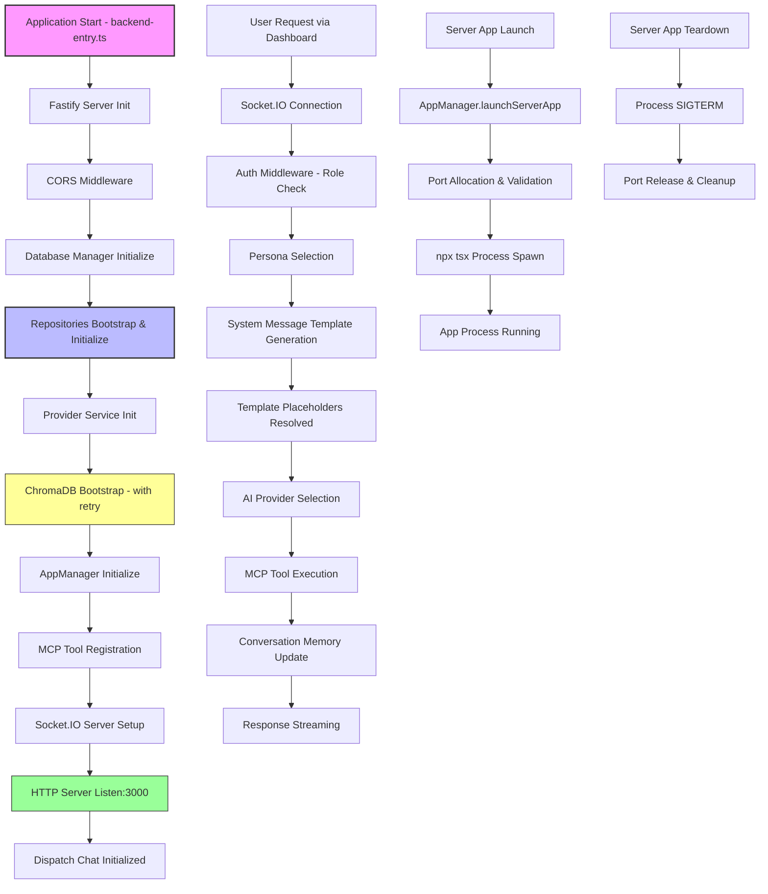

# CLAUDE.md

This file provides comprehensive guidance to Claude Code (claude.ai/code) when working with code in THE-LAB, an agentic orchestrated workflow platform designed for building Apps with intelligent collaboration.

## THE-LAB VISION

THE-LAB leverages a team of specialized personas (Architect, Code, Debug, QA, etc.) working in concert to deliver high-quality software outcomes. You coordinate between these personas to provide strategic guidance, technical implementation, and quality validation. THE-LAB Apps are at the core of the system and it is your role to assist the user in App management/usage.

### Core Directives
- **App metadata** (description, order, faIcon, server port, etc.) must be changed using the **App Management Tool**
- **App functionality and styling changes** require direct modification of source code files using appropriate tools
- **CRITICAL**: When modifying App source code that involves 3rd party libraries, you MUST use the Context7 MCP Tool to retrieve the latest library documentation before making changes.
- **CRITICAL**: All interactive elements in `src/apps` folder (PrimeVue components and native HTML) MUST use `useUniqueElementId()` composable from `@/shared/composables/useUniqueElementId` to generate globally unique IDs for UI automation reliability. PrimeVue components require `:pt="{ root: { attrs: { id: generateUniqueId('...') } }}"`, native elements require `:id="generateUniqueId('...')"`.
- **CRITICAL**: When creating new Vue components in the apps folder, always import and use `useUniqueElementId()` for all interactive elements before adding them to templates.
- **CRITICAL**: **All drag-and-drop** in `src/apps/**` MUST use **`@vue-dnd-kit/core`** only (see `src/apps/dnd-examples/`, [docs/platform/platform-theming.md](docs/platform/platform-theming.md) § Drag and drop).
- **LLM chat providers:** When adding or changing chat backends, follow [src/backend/ai/providers/README.md](src/backend/ai/providers/README.md) — `resolveChatRequestOptions` + `mapChatRequestPayload()`, `provider-adapter-factory.ts`, and `chat-request-payload.test.ts`.

### Production readiness — agent reminders

- **Sign-in:** Platform auth uses `LabSessionService` (HTTP cookie + JWT). **OIDC IdPs** (Google, GitHub, Microsoft Entra) are registered only via **Settings → Auth Providers** in SQLite — do not document or configure IdP client secrets in `.env` for runtime login. See [docs/auth/oidc-jit-phase1.md](docs/auth/oidc-jit-phase1.md).
- **Roles:** Global roles (`owner` / `admin` / `member` / `viewer`) gate launch, teardown, user management, and MCP production policy. **Viewer** cannot launch apps.
- **Production profile:** When `LAB_PRODUCTION_PROFILE=1`, MCP execution uses production enforcers (app-scoped file paths, stdio MCP allowlists, etc.). Match patterns in existing tools/tests under `src/tests/regression/backend/mcp-production-enforcer.test.ts`.
- **App APIs:** Hybrid/server app HTTP/WebSocket targets use the **app server port** (`props.serverUrl`, 4000–4999), not main backend **3000**.
- **CI:** Canonical branch **`master`**. Azure PRs run CI v1 only (`verify:test-tiers`, `lint`, `type-check`, **`test:ci`**, `build`); Playwright smoke is **`npm run test:smoke`** locally or optional manual Azure pipeline; **`npm run test:regression`** (356 suites) before risky merges — [docs/ci/ci-v1-contract.md](docs/ci/ci-v1-contract.md).
- **Pre-PR:** Run **`npm run test:pipeline`** and confirm it passes before creating any pull request (`lint` → `type-check` → `verify:test-tiers` → `verify:domain-event-manifests` → `test:ci` → `build`; smoke is separate).
- **Lab stack:** `npm run lab:start` / `lab:stop` orchestrate Chroma + backend + Vite — [docs/operations/lab-stack.md](docs/operations/lab-stack.md).
- **Platform user id:** App domain data should reference THE-LAB `users.id` (platform identity API); per-app reserved `users` tables are not product identity.
- **Platform theming:** One saved theme for the lab — **20 built-in presets** (10 dark / 10 light), admin **Settings → Themes**, live draft + Save. Tokens on `:root` as `--lab-*`; apps/charts inherit via `lab-app-theme.ts` / `lab-chart-theme.ts`. User guide: [docs/platform/platform-theming.md](docs/platform/platform-theming.md). Agents: use `lab-*` utilities for shell/chat chrome; **all app surfaces** (lobby + in-game views) must follow tokens; register new built-ins in `LAB_THEME_PRESET_IDS` only (no ad-hoc SQL).
- **Vue scoped CSS / `:deep()`:** Tailwind + `lab-*` on template nodes you own; prefer PrimeVue **Pass Through** (`:pt`, `form-control-pt`, `lab-primevue-pt.ts`) before adding piercing CSS. **Do not** mass-remove existing `:deep()` / `:global()` — keep them when PrimeVue teleports, PT keys are unclear, or third-party markup is involved (**err on caution**).
- **Team messaging:** Human DMs via `/lab-comms` + `LAB_COMMS_EVENTS` only (not Lab Assistant `SOCKET_EVENTS`). Socket-only v1 — [docs/platform/lab-messaging.md](docs/platform/lab-messaging.md).
- **Lab app integrations:** Manifest slots + bindings + `LabIntegrationSurface`; seed gate `npm run verify:integration-seeds` — [docs/platform/lab-app-integrations.md](docs/platform/lab-app-integrations.md).
- **Lab domain events:** Register published types in the app's `shared/lab-domain-events.manifest.ts`, add the file to `domain-event-manifest-index.ts`, gate with `npm run verify:domain-event-manifests` — [docs/platform/lab-domain-events.md](docs/platform/lab-domain-events.md).
- **Lab virtual bank (Quarks):** Play-money ledger on main DB; games settle via match adapters or workflow — [docs/platform/lab-virtual-bank.md](docs/platform/lab-virtual-bank.md). Shared game kit: `src/shared/game-platform/` (`MatchOutcome` uses `'loss'`, not `'lose'`). **Play vs Lab Assistant:** vs-AI catalog games declare **`agentMode: 'llm'`**; opponents move via the configured provider (`createTurnBasedAdapter` + structural tools), not scripted engines — see [`difficulty-policy.ts`](src/shared/game-platform/difficulty-policy.ts) and [`resolve-agent-move.ts`](src/shared/game-platform/resolve-agent-move.ts). Blackjack seat 2 is LLM; only the **house dealer** is rules-scripted.

---

## System Architecture Deep Dive

### Application Entry and Startup Flow

Application startup initiates via [`src/backend-entry.ts`](src/backend-entry.ts:1):
1. `backend-entry.ts` imports and calls [`startServer()`](src/backend/server.ts:96) from the main server module
2. Server initialization sequence executes in the following order:
   - Fastify instance created with logging enabled: [`server = fastify({ logger: true })`](src/backend/server.ts:48)
   - CORS middleware registered for cross-origin requests: [`server.register(fastifyCors, ...)`](src/backend/server.ts:51)
   - Main database connection established via [`databaseManager.initialize()`](src/backend/db/DatabaseManager.ts:45)
   - AI provider service instantiated: [`ProviderService.getInstance()`](src/backend/ai/provider-service.ts:24)
   - ChromaDB bootstrapped for conversation memory via [`bootstrapChroma()`](src/backend/chroma/chroma-bootstrap.ts:3)
   - AppManager initialized for server-side app process management
   - MCP tools registered during server startup
   - Socket.IO server created and bound to underlying HTTP server
   - HTTP server listens on port 3000

### Database Architecture ([`src/backend/db/DatabaseManager.ts`](src/backend/db/DatabaseManager.ts))

The main application database uses better-sqlite3 with strict configuration:
- Default path: `db/the_lab.db` (configurable via `DATABASE_PATH` env var)
- WAL (Write-Ahead Logging) journal mode enabled
- Foreign keys constraint globally ON
- Synchronous mode set to FULL for data durability
- Journal mode: WAL

Repository initialization sequence ([`DatabaseManager.connect()`](src/backend/db/DatabaseManager.ts:27) → [`DatabaseManager.initialize()`](src/backend/db/DatabaseManager.ts:45)):
1. `authRepository.bootstrap(this.db)` - User authentication and role management
2. `aiProviderRepository.bootstrap(this.db)` - AI provider configuration
3. `appsRepository.bootstrap(this.db)` - App registry and metadata
4. `personaRepository.bootstrap(this.db)` - Persona definitions and tools
5. `commandRepository.bootstrap(this.db)` - Slash command definitions
6. `toolsRepository.bootstrap(this.db)` - MCP tool metadata
7. `contextSettingsRepository.bootstrap(this.db)` - Context and configuration settings
8. `userInstructionsRepository.bootstrap(this.db)` - User instruction configurations

Each repository follows the pattern: `bootstrap(this.db)` for schema creation, then `initialize()` for data seeding and validation.

### Per-App Database Isolation ([`src/backend/AppDatabaseService.ts`](src/backend/AppDatabaseService.ts:13))

Each server-side App gets its own isolated SQLite database for data isolation:
- Location: `src/apps/{app-id}/db/the_lab.db`
- Created and managed by [`AppDatabaseService.getInstance(appId)`](src/backend/AppDatabaseService.ts:24)
- Uses [`AppDatabaseManager`](src/backend/AppDatabaseManager.ts) singleton for connection pooling
- Supports migration system via `{appName}_migrations` tracking table
- Standard tables: users, items, configs, logs (configurable)

### Singleton Pattern Implementation

All services follow the singleton pattern via static `getInstance()` methods:

| Singleton | Purpose | File |
|-----------|---------|------|
| [`databaseManager`](src/backend/db/DatabaseManager.ts:60) | Main database access | [`src/backend/db/DatabaseManager.ts`](src/backend/db/DatabaseManager.ts) |
| [`ProviderService`](src/backend/ai/provider-service.ts:24) | AI provider orchestration | [`src/backend/ai/provider-service.ts`](src/backend/ai/provider-service.ts) |
| [`ConversationMemory`](src/backend/chroma/conversation-memory.ts) | ChromaDB conversation storage | [`src/backend/chroma/conversation-memory.ts`](src/backend/chroma/conversation-memory.ts) |
| [`MCPToolRegistry`](src/backend/mcp/mcp-tool.ts:6) | MCP tool registration | [`src/backend/mcp/mcp-tool.ts`](src/backend/mcp/mcp-tool.ts) |
| [`AppManager`](src/backend/AppManager.ts:88) | Server app process management | [`src/backend/AppManager.ts`](src/backend/AppManager.ts) |
| [`VSCodeLogger`](src/backend/utils/logger.ts) | Central logging service | [`src/backend/utils/logger.ts`](src/backend/utils/logger.ts) |
| [`AppDatabaseService`](src/backend/AppDatabaseService.ts:24) | Per-app database instances | [`src/backend/AppDatabaseService.ts`](src/backend/AppDatabaseService.ts) |
| [`roleManager`](src/shared/services/RoleManager.ts:201) | Role/permission management | [`src/shared/services/RoleManager.ts`](src/shared/services/RoleManager.ts) |

**CRITICAL RULE**: Never create multiple instances of any singleton. Always use `Class.getInstance()` pattern.

### App Types and Structure ([`src/shared/types/app/App.ts`](src/shared/types/app/App.ts))

Three App types support different deployment strategies:

| Type | Description | File Structure |
|------|-------------|----------------|
| Browser apps | Pure Vue SFC components rendered in dashboard | `src/apps/{app-id}/front-end/App.vue` |
| Server apps | Node.js processes via `npx tsx`, dynamic ports 4000-4999 | `src/apps/{app-id}/back-end/entry.ts` |
| Hybrid apps | Both browser component AND server process | Both front-end and back-end directories |

App class structure from [`App.ts`](src/shared/types/app/App.ts:4):
- `id`, `name`, `description`, `faIcon`, `order`
- `type`: 'browser' | 'server' | 'hybrid'
- `componentPath`: Path to Vue SFC (browser apps)
- `version`: Semantic versioning (default: '1.0.0')
- `dependencies`: Array of required app IDs
- `optionalDependencies`: Array of optional app IDs
- `server`: IServerConfig object for server apps (entry, port)
- `isEnabled`, `isServerSideEnabled`: boolean flags
- `lifecycle`: ILifecycleHooks for before/after events

### App Lifecycle Flow ([`src/backend/AppManager.ts`](src/backend/AppManager.ts:78))

Server app management handles the complete lifecycle:

**App Launch:**
1. `AppManager.launchServerApp(appId)` - Main entry point
2. Validates app exists and is enabled via [`appsService`](src/backend/db/Apps/apps-service.ts)
3. Acquires lock to prevent concurrent launches
4. Checks for port conflicts via `pidForPort` map
5. Determines port from `app.server.port` or uses `defaultPortOffset`
6. Spawns child process via `spawn()` with `npx tsx` runner
7. Monitors process state and tracks in `runningApps` Map
8. Registers port-to-PID mapping to prevent conflicts

**Resource Limits:**
- CPU time limit (default: Infinity)
- Memory limit (default: 512MB)
- Port reuse detection to prevent zombie processes

**Graceful Teardown:**
1. Sends SIGTERM signal to child process
2. Awaits process termination (timeout enforced)
3. Releases port from `pidForPort` map
4. Cleans up from `runningApps` Map
5. Logs teardown completion

### Dependency Resolution ([`src/shared/services/DependencyGraph.ts`](src/shared/services/DependencyGraph.ts))

Complex app relationships are managed through topological sorting with cycle detection:

**Construct:**
```typescript
new DependencyGraph(apps: IApp[])
```
Builds adjacency map where each app ID maps to its dependency set.

**Topological Sort - `getStartupOrder()`:**
- Returns apps in correct startup order (dependencies before dependents)
- Uses DFS post-order traversal
- Ensures dependencies are resolved before dependent apps

**Cycle Detection - `hasCycle()`:**
- Uses three-color DFS marking (WHITE/GRAY/BLACK)
- WHITE (0): not visited
- GRAY (1): currently being processed (in recursion stack)
- BLACK (2): fully processed
- Returns true if back edge detected (cycle exists)

### Role-Based Access Control ([`src/shared/services/RoleManager.ts`](src/shared/services/RoleManager.ts))

Four-tier role hierarchy with permission levels:

| Role | Launch | Teardown | Update | Delete | Manage Users | View Logs | Manage Apps | Create Apps |
|------|--------|----------|--------|--------|--------------|-----------|-------------|-------------|
| owner | ✓ | ✓ | ✓ | ✓ | ✓ | ✓ | ✓ | ✓ |
| admin | ✓ | ✓ | ✓ | ✗ | ✓ | ✓ | ✓ | ✓ |
| member | ✓ | ✓ | ✗ | ✗ | ✗ | ✗ | ✗ | ✗ |
| viewer | ✗ | ✗ | ✗ | ✗ | ✗ | ✗ | ✗ | ✗ |

- Default permissions defined in [`DEFAULT_ROLES`](src/shared/services/RoleManager.ts:27)
- `canPerformAction(user, action)` checks global permissions
- Role hierarchy for C3 (Cascading Consensus) resolution: owner=4, admin=3, member=2, viewer=1
- Custom app-level permissions can be merged via `mergePermissions(base, overrides)`

### File Operations Helper ([`src/backend/utils/file-helpers.ts`](src/backend/utils/file-helpers.ts))

Centralized file I/O with cross-platform compatibility:

**Path Handling:**
- Always use [`fileHelpers.toForwardPath()`](src/backend/utils/file-helpers.ts:18) for all file paths (converts `\` to `/`)
- Paths are relative to `process.cwd()` (project root)
- Use [`fileHelpers.fetchRepoFiles()`](src/backend/utils/file-helpers.ts) for complete repository listing

**Error-Safe Delete:**
- [`fileHelpers.deleteFile(relativePath)`](src/backend/utils/file-helpers.ts:78) returns `true` if deleted OR didn't exist (silent success)
- Returns `false` on actual errors
- Uses `fs.promises.rm()` with `{ force: true }` option

**Directory Traversal:**
- `fileHelpers.traverseDirectory()` yields full file paths recursively
- Used by template manager for repo file listing

**Excluded Directories:**
```typescript
EXCLUDED_DIRS: ['.roo', '.git', '.vscode', 'chroma-data', 'dist', 'logs', 'node_modules', 'docs']
```
Filter applied during file operations to prevent unwanted access.

### MCP Server Architecture ([`src/backend/mcp/`](src/backend/mcp/))

THE-LAB has evolved from internal tools to a full MCP (Model Context Protocol) server architecture with support for both stdio and HTTP transports.

#### Core Components

| Component | File | Purpose |
|-----------|------|---------|
| [`MCPServerLoader`](src/backend/mcp/mcp-server-loader.ts:12) | Singleton per user | Loads and manages external MCP servers |
| [`StdioProvider`](src/backend/mcp/mcp-server-providers/stdio-provider.ts:23) | Stdio transport implementation | Spawns child processes for stdio-based servers |
| [`StreamableHTTPProvider`](src/backend/mcp/mcp-server-providers/streamable-http-provider.ts:8) | HTTP transport implementation | Connects to streamable HTTP MCP servers |
| [`MCPToolRegistry`](src/backend/mcp/mcp-tool.ts:27) | Tool registry singleton | Registers and exposes tools to AI agents |

#### Transport Types Supported

- **`stdio`** - Command-line process spawning (e.g., `npx`, `python`)
- **`streamable-http`** - HTTP-based MCP servers with JSON-RPC over HTTP

#### User-Configurable MCP Servers

The settings now allow users to add custom MCP servers via the [`MCPServerManagement`](src/dashboard/components/settings/MCPServerManagement.vue:74) component.

**Database Schema ([`user_mcp_servers`](src/backend/db/MCPServers/mcp-servers-schema.ts:3)):**
```sql
CREATE TABLE user_mcp_servers (
    id INTEGER PRIMARY KEY AUTOINCREMENT,
    userid INTEGER NOT NULL,
    name TEXT NOT NULL,
    command TEXT,              -- e.g., 'npx', 'python'
    args TEXT,                 -- JSON array of arguments
    url TEXT,                  -- For HTTP transport
    transport TEXT DEFAULT 'stdio',
    timeout INTEGER DEFAULT 30,
    enabled INTEGER DEFAULT 1,
    cwd TEXT,                  -- Working directory
    env TEXT,                  -- Environment variables (JSON)
    headers TEXT,              -- HTTP headers (JSON)
    tools TEXT,                -- Tool definitions (JSON)
    created_at DATETIME,
    updated_at DATETIME
);
```

**Default MCP Servers Seeded:**
| Server | Transport | Tools |
|--------|-----------|-------|
| `datetime` | stdio | 9 datetime utilities |
| `the-lab-db` | stdio | 5 SQLite query tools |

#### Tool Wrapper Pattern

External MCP server tools are wrapped in [`MCPToolInterface`](src/shared/types/mcp-tools.ts) implementations that:
- Parse the external server's `inputSchema` into Zod schemas
- Delegate execution to the transport provider
- Mark as `isExternal: true` for identification

**See:** [`MCPServerLoader.extractAndRegisterTools()`](src/backend/mcp/mcp-server-loader.ts:122)

#### Connection Retry Logic

- **Stdio**: Single attempt with stderr event monitoring
- **HTTP**: Up to 5 attempts with 25% timeout intervals between retries

### MCP Tool Interface ([`src/shared/types/mcp-tools.ts`](src/shared/types/mcp-tools.ts))

**Requirements:**
1. Class MUST implement `MCPToolInterface<S extends z.ZodObject<any>>` with Zod schema as generic
2. Tool ID must be unique and snake_case
3. Params MUST be Zod schemas, NOT plain objects (use `z.infer<typeof Schema>`)
4. Register in [`src/backend/server.ts`](src/backend/server.ts) during startup via `mcpRegistry.register()`
5. `execute()` returns `{ success: boolean, content: string }` - NOT standard MCP JSON format

**Tool Registration Sequence** ([`src/backend/server.ts`](src/backend/server.ts:73)):
```typescript
await mcpRegistry.loadDefaultServers()
```

The `loadDefaultServers()` method in [`MCPToolRegistry`](src/backend/mcp/mcp-tool.ts:110) registers all default MCP servers using the `registerMCPServer()` method which connects to in-memory transport and adapts tools via [`MCPToolAdapter`](src/backend/mcp/utils/mcp-tool-adapter.ts):

```typescript
public async loadDefaultServers(): Promise<void> {
  await this.registerMCPServer(createDirectoryMcpServer, createDirectoryToolsManifest);
  await this.registerMCPServer(createFileMcpServer, createFileToolsManifest);
  await this.registerMCPServer(appManagementMcpServer, appManagementToolsManifest);
  await this.registerMCPServer(listFilesMcpServer, listFilesToolsManifest);
  await this.registerMCPServer(readFileMcpServer, readFileToolsManifest);
  await this.registerMCPServer(removeDirectoryMcpServer, removeDirectoryToolsManifest);
  await this.registerMCPServer(removeFileMcpServer, removeFileToolsManifest);
  await this.registerMCPServer(updateFileMcpServer, updateFileToolsManifest);
  await this.registerMCPServer(webFetchMcpServer, webFetchToolsManifest);
  await this.registerMCPServer(webQueryMcpServer, webQueryToolsManifest);
  await this.registerMCPServer(todoListMcpServer, todoListToolsManifest);
  await this.registerMCPServer(personaManagerMcpServer, personaManagerToolsManifest);
  await this.registerMCPServer(context7McpServer, context7ToolsManifest);
  await this.registerMCPServer(awaiterMcpServer, awaiterToolsManifest);
  await this.registerMCPServer(runTerminalCommandMcpServer, runTerminalCommandToolsManifest);
  await this.registerMCPServer(documentorMcpServer, documentorToolsManifest);
  await this.registerMCPServer(followupMcpServer, followupToolsManifest);
  await this.registerMCPServer(uiAutomationMcpServer, uiAutomationToolsManifest);
  await this.registerMCPServer(searchRepositoryMcpServer, searchRepositoryToolsManifest);
}
```

Each MCP server is defined in its own module under [`src/backend/mcp/mcp-servers/`](src/backend/mcp/mcp-servers/) and exports both the server instance and tools manifest.

### ChromaDB Connection ([`src/backend/chroma/chroma-bootstrap.ts`](src/backend/chroma/chroma-bootstrap.ts))

Vector database for conversation memory with retry logic:

**Connection Retry Sequence:**
- First attempt: waits 2.5 seconds
- Subsequent attempts: 500ms intervals
- Total attempts: 20
- All retries exhausted → `process.exit(1)` (hard failure, no silent recovery)

**ConversationMemory:**
- Persisted via ChromaDB collections
- Stores session context and message history
- Used by AI providers for context awareness

### Template System ([`src/backend/utils/template-manager.ts`](src/backend/utils/template-manager.ts))

Dynamic system message generation with placeholder resolution:

**Template Placeholders:**
- `{{sessionId}}` - Current session ID
- `{{CURRENT_PERSONA_NAME}}` - Active persona name
- `{{CURRENT_PERSONA_ROLE}}` - Active persona role description
- `{{CURRENT_PERSONA_CAPABILITIES}}` - Active persona capabilities
- `{{CURRENT_PERSONA_OUTPUT}}` - Expected output format
- `{{CURRENT_PERSONA_RULES}}` - Persona specific rules
- `{{ALL_PERSONAS_MCPTOOL_MAP}}` - Persona to MCP tools mapping
- `{{COMMANDS_AVAILABILITY_COUNT}}`, `{{COMMANDS_AVAILABILITY_MAP}}` - Available slash commands
- `{{MCPTOOL_AVAILABILITY_MAP}}` - Persona-specific MCP tools
- `{{ACTIVE_TODO_LISTS}}` - Current todo lists
- `{{REPO_FILE_LIST_FRONTEND}}`, `{{REPO_FILE_LIST_BACKEND}}`, `{{REPO_FILE_LIST_SHARED}}`, `{{REPO_FILE_LIST_TEST}}` - File listings
- `{{ACTIVE_APPS}}` - Currently running apps overview

**Template Resolution Order:**
1. System message base template
2. Session context with ID
3. Current persona configuration
4. Available personas map
5. Active apps status
6. Slash commands
7. MCP tools (persona-filtered)
8. Todo lists
9. Repository file listing
10. Key command scripts

### THE-LAB Dual-View Architecture

THE-LAB has two simultaneous views that can be toggled between:

**Laboratory** (full-screen chat interface; formerly Lab Assistant view):
- Purpose: User chats with AI agent via MCP tools
- Controlled by `focusedAssistant` ref in [`useLabDashboard.ts`](src/shared/composables/components/useLabDashboard.ts)
- When focused: Apps workspace is blurred (`blur-[20px]`, `opacity-50`) and pushed down

**Apps workspace** (app catalog + mounted apps):
- Purpose: Shows available apps and launches server-side applications
- Controlled by `focusedAssistant` ref in [`useLabDashboard.ts`](src/shared/composables/components/useLabDashboard.ts)
- When focused: Laboratory is blurred (`blur-[20px]`, `opacity-50`)

**View Switching Behavior:**
- Both views are **always present in the DOM** - only visually obscured via CSS blur/opacity and positioning transitions
- Focus switching is purely visual (CSS transitions), not DOM manipulation
- **Laboratory focus:** quick nav **Laboratory** or the comment-dots control in the brand header (`focusAssistant()`)
- **Apps workspace focus:** click the app/catalog region (e.g. chat splitter panel wired to `focusLab()`)
- On the apps workspace, **Lab Sidecar** (**Lab Assistant** chip, top-right) provides in-context chat without full Laboratory focus; see [docs/platform/lab-sidecar.md](docs/platform/lab-sidecar.md). Chat preview was removed in favor of Sidecar.

**Implications for UI Automation:**
- Agents can discover and interact with elements in BOTH views regardless of which is focused
- `discoverElements` or `elementAction` operation both work on blurred/hidden elements
- The "visible" check in [`UIAutomationHandler.isElementVisible()`](src/dashboard/services/ui-automation-handler.ts:999) checks for `display:none`, `visibility:hidden`, or `opacity:0` - NOT blur state
- Sidecar replies appear in the Sidecar panel; full Laboratory focus shows the full transcript including tool activity

**UI Mode Switching Visual Indicators:**
- **Quick nav** (top left): Settings, Laboratory, Messages, About
- **Lab Sidecar**: top-right on apps workspace when Laboratory is not focused
- When in Laboratory, the apps workspace is blurred
- When in the apps workspace, the full Laboratory layer is blurred; Sidecar remains available on the apps shell

Glossary: `docs/platform/lab-shell-terminology.md`

### System Message Base Template ([`src/shared/templates/sysMsg.md`](src/shared/templates/sysMsg.md:1))

Core agent behavior and platform documentation embedded in system messages:

**Platform Overview:** THE-LAB is an agentic workflow platform for building Apps with:
- Specialized personas collaborating on tasks
- App management through dedicated tools
- File system operations for code modification
- AI-powered reasoning and delegation

**Agent Communication Rules:**
1. Respond in plain text with proper markdown formatting (headers, lists, code blocks)
2. Never output raw JSON unless explicitly requested
3. Be friendly, clear, specific, and safe
4. Confirm destructive operations with user
5. Reference files and tools by exact names

**Workflow Steps:**
1. Understand user intent
2. Create plan using todo_list tool
3. Delegate to persona_manager if needed
4. Execute file operations with appropriate tools
5. Document results
6. Validate changes

## Build & Test Commands

- **Pre-PR gate (required before opening a PR)**: `npm run test:pipeline` — runs `lint`, `type-check`, `verify:test-tiers`, `verify:domain-event-manifests`, `test:ci`, then `build`; exits on the first failure
- **Full startup**: `npm run dev` - Runs ChromaDB + Vite + backend concurrently
- **Start backend only**: `npm run back-end`
- **Start frontend only**: `npm run front-end` (Vite dev server)
- **Build**: `npm run build`
- **Lint**: `npm run lint`
- **Type check**: `npm run type-check`
- **Type check single file**: `npm run type-check-file <file>`
- **Verify test tiers**: `npm run verify:test-tiers` — asserts ci/regression partition (356 suites total)
- **CI gate (Azure PRs)**: `npm run test:ci` — `src/tests/ci/**` only (158 suites)
- **Full regression**: `npm run test:regression` — every Jest suite (356)

### Test Execution

Tests live under `src/tests/ci/` (fast gate) or `src/tests/regression/` (boot/DB/MCP suites). See [docs/ci/ci-v1-contract.md](docs/ci/ci-v1-contract.md).

- `npm run test` — alias for full Jest run
- `npm run test:name "pattern"` — filter by test name
- `npm run test:path "pattern"` — filter by file path
- Jest configured with `--experimental-vm-modules` flag

## Critical Architecture Patterns

### Repository Pattern

All database access uses repository classes:
- `bootstrap(this.db)` - Creates tables, initializes schema
- `initialize()` - Seeds data, validates state
- Separate repositories for each domain (auth, apps, persona, command, tools, contextSettings, aiProvider)

**Repository Files:**
- [`src/backend/db/Auth/auth-repository`](src/backend/db/Auth/auth-repository)
- [`src/backend/db/Apps/apps-repository`](src/backend/db/Apps/apps-repository)
- [`src/backend/db/Persona/persona-repository`](src/backend/db/Persona/persona-repository)
- [`src/backend/db/Command/command-repository`](src/backend/db/Command/command-repository)
- [`src/backend/db/Tools/tools-repository`](src/backend/db/Tools/tools-repository)
- [`src/backend/db/ContextSettings/context-settings-repository`](src/backend/db/ContextSettings/context-settings-repository)
- [`src/backend/db/AIProvider/ai-provider-repository`](src/backend/db/AIProvider/ai-provider-repository)

### Service Pattern

Business logic is encapsulated in service classes:
- [`src/backend/db/Apps/apps-service`](src/backend/db/Apps/apps-service) - App CRUD operations
- [`src/backend/db/Persona/persona-service`](src/backend/db/Persona/persona-service) - Persona management
- [`src/backend/db/Command/command-service`](src/backend/db/Command/command-service) - Command registry
- [`src/backend/db/Tools/tools-service`](src/backend/db/Tools/tools-service) - Tool metadata
- [`src/backend/ai/provider-service`](src/backend/ai/provider-service) - AI provider orchestration

### Error Handling Conventions

- Async functions return `{ success: boolean, content: string }` format
- Delete operations return `boolean`: true if deleted/missing, false on error
- Silent failures acceptable for non-critical operations (file deletions)
- Use [`VSCodeLogger`](src/backend/utils/logger.ts) for centralized logging

### Graceful Shutdown ([`src/backend/server.ts`](src/backend/server.ts:148))

Both server instances must be closed on SIGTERM:
```typescript
async () => {
    server.close()
    httpServer.close()
    // Logs: "Server closed gracefully"
}
```

Missing shutdown handling can leave ChromaDB and database connections in inconsistent state.

## Environment Variables

| Variable | Description | Default |
|----------|-------------|---------|
| `DATABASE_PATH` | Custom SQLite database location | `db/the_lab.db` |
| `BACKEND_URL` | Override backend URL for frontend | `http://localhost:3000` |
| `VITE_LOGGING_ENABLED` | Enable/disable file logging (0 or 1) | `1` |
| `LOG_OUTPUT_PATH` | Path for log files (when logging enabled) | N/A |
| `DEFAULT_SERVER_PORT_OFFSET` | Base port offset for server apps | N/A |

## Port Configuration

- **Backend server**: Fixed port 3000 (never change)
- **Server apps**: Dynamic ports 4000-4999 (via `envConfig.defaultPortOffset`)
- Port-to-PID cache prevents conflicts in [`AppManager`](src/backend/AppManager.ts)

## Architecture Flow Diagram



## Common Development Tasks

### Adding a New MCP Tool

1. Create tool class in `src/backend/mcp/tools/`:
   - Implement `MCPToolInterface<ZodSchema>`
   - Define Zod schema for params
   - Implement `execute()` returning `{ success: boolean, content: string }`
2. Register in [`src/backend/server.ts`](src/backend/server.ts) during startup:
   ```typescript
   mcpRegistry.register(new MyNewTool())
   ```

### Adding a New App

1. Add app definition to SQLite via [`appsService`](src/backend/db/Apps/apps-service):
   - Use `AppManagementTool` or direct SQL
2. Create Vue component for browser apps in `src/apps/{app-id}/front-end/`
3. Create server entry in `src/apps/{app-id}/back-end/entry.ts` for server apps
4. Configure `IServerConfig` with entry path and port
5. Define dependencies in app definition

### Adding a New AI Provider

See **[src/backend/ai/providers/README.md](src/backend/ai/providers/README.md)** for the full checklist. Summary:

1. Create adapter class in `src/backend/ai/providers/` implementing `LLMProvider` (including `resolveChatRequestOptions` → `mapChatRequestPayload()`).
2. Register in [`provider-adapter-factory.ts`](src/backend/ai/provider-adapter-factory.ts) and update [`lab-provider-capabilities.ts`](src/shared/config/lab-provider-capabilities.ts) when needed.
3. Extend [`chat-request-payload.test.ts`](src/tests/backend/chat-request-payload.test.ts). Chat/embed wiring uses `buildProviderAdapter` via [`ProviderService`](src/backend/ai/provider-service.ts).

### Creating New Personas

1. Create persona definition in database via [`personaService`](src/backend/db/Persona/persona-service)
2. Define reasoning modes (deep_analysis, critical, concise, etc.)
3. Assign MCP tools to persona
4. Configure system message with persona rules

## Code Structure Overview

```
src/
├── App.vue                              # Root Vue component
├── backend-entry.ts                     # Application entry point
├── main.ts                              # Vue application bootstrap
├── apps/                                # Apps directory (read-only)
│   ├── ui-component-gallery/front-end/
│   └── ...
├── assets/
│   └── styles/
├── backend/                             # Backend server code
│   ├── ai/
│   │   ├── provider-service.ts          # AI provider orchestration
│   │   └── providers/                   # OpenAI/Ollama adapters
│   ├── chroma/                          # ChromaDB integration
│   │   ├── chroma-bootstrap.ts          # Bootstrap with retry
│   │   ├── chroma-init.ts               # ChromaDB initialization
│   │   ├── conversation-memory.ts       # Conversation storage
│   │   └── provider-embed.ts            # Provider embeddings
│   ├── db/                              # SQLite layer
│   │   ├── Auth/                        # Authentication
│   │   ├── Apps/                        # App registry
│   │   ├── AIProvider/                  # AI providers
│   │   ├── Persona/                     # Personas
│   │   ├── Command/                     # Commands
│   │   ├── Tools/                       # MCP tools
│   │   ├── ContextSettings/             # Context settings
│   │   └── AppDatabaseService.ts        # Per-app DB isolation
│   ├── mcp/                             # MCP tool registry
│   │   └── tools/                       # Individual MCP tools
│   ├── middleware/                      # Auth middleware
│   ├── routes/                          # API endpoints
│   ├── utils/                           # Utilities
│   │   ├── file-helpers.ts              # File I/O helpers
│   │   ├── logger.ts                    # VSCodeLogger
│   │   ├── mcp-utils.ts                 # MCP utilities
│   │   ├── parse-utils.ts               # Parse helpers
│   │   ├── persona-data-service.ts      # Persona data
│   │   └── template-manager.ts          # System message templates
│   └── server.ts                        # Main Fastify server
├── dashboard/                           # Dashboard UI components
│   ├── components/
│   │   ├── app/                         # App cards/containers
│   │   ├── chat/                        # Chat UI
│   │   ├── file-overview/               # File browser
│   │   ├── settings/                    # Settings panels
│   │   └── todo-list/                   # Todo list
│   └── LabDashboard.vue                 # Main dashboard
├── scripts/                             # Build scripts
│   ├── generate-app.ts                  # App generation
│   └── sync-app-dirs.ts                 # Directory sync
├── services/                            # App lifecycle services
│   ├── AppGateway.ts                    # Client gateway
│   ├── AppLifecycle.ts                  # Lifecycle management
│   ├── AppUpdateManager.ts              # Update orchestration
│   ├── ComponentLoader.ts               # Component loading
│   ├── DependencyGraph.ts               # Dependency resolution
│   └── RoleManager.ts                   # Role permissions
├── shared/                              # Shared between frontend/backend
│   ├── composables/                     # Vue composables
│   ├── config/                          # Configuration
│   │   ├── database.ts                  # DB settings
│   │   └── env.ts                       # Environment config
│   ├── services/                        # Core services
│   │   ├── AppRegistry.ts               # App registry (shared)
│   │   ├── ServerAppRegistry.ts         # Server app registry
│   │   └── TemplateGenerator.ts         # Template generation
│   ├── templates/                       # System message templates
│   │   ├── active-todo-lists.md
│   │   ├── available-mcp-tools.md
│   │   ├── available-personas.md
│   │   ├── current-persona.md
│   │   ├── key-command-scripts.md
│   │   ├── repo-files.md
│   │   ├── session-context.md
│   │   ├── slash-commands.md
│   │   ├── sysMsg.md                    # Base system message
│   │   ├── the-lab-apps.md              # App documentation
│   │   └── db/schemas/                  # Database schemas
│   └── types/                           # TypeScript types
├── tests/                               # Test files
└── test-files/                          # Test fixtures
```

## Error Handling Checklist

| Scenario | Error Type | User Impact | Mitigation |
|----------|------------|-------------|------------|
| Database fail to connect | ConnectionError | Application crash | Hard failure after retries |
| ChromaDB timeout | TimeoutError | No conversation memory | Retry logic with exponential backoff |
| Port in use | EADDRINUSE | App launch fail | Randomize port offset |
| File permission denied | PermissionError | Operations fail | Log and continue |
| Port binding fail | BindError | Service unavailable | Fallback behavior |

## Testing Conventions

### Test Structure
```typescript
describe('Calculator', () => {
  describe('add()', () => {
    test('adds two numbers', () => {
      // test implementation
    })
  })
})
```

### MCP Tool Test Pattern
```typescript
test('execute() returns success response', async () => {
  const params: ToolParams = { fileId: 'test.txt' }
  const result = await tool.execute(params)
  expect(result.success).toBe(true)
  expect(result.content).toContain('Success')
})
```

### Integration Test Example
```typescript
describe('File Operations Workflow', () => {
  test('creates and reads file', async () => {
    // Create file via MCP
    // Read file via MCP
    // Verify content
    // Cleanup
  })
})
```

## Type-Safety Rules

- All file paths in MCP tools MUST use `fileHelpers.toForwardPath()`
- Zod schemas for all MCP tool parameters
- Never modify files outside `src/apps/*` directory
- TypeScript strict mode enabled
- Runtime validation via Zod before execution

## Key MCP Tools Reference

| Tool | Purpose | Parameters |
|------|---------|------------|
| `CreateDirectoryTool` | Create directory | `dirPath` |
| `CreateFileTool` | Create file with content | `filePath`, `content`, `directory` |
| `UpdateFileTool` | Update file content | `filePath`, `changes` |
| `ReadFileTool` | Read file content | `filePath` |
| `ListFilesTool` | List directory files | `directory` |
| `SearchRepositoryTool` | Semantic code search | `query` |
| `WebFetchTool` | Fetch webpage content | `url` |
| `WebQueryTool` | Query web with AI | `query` |
| `Context7Tool` | Get library documentation | `query` |
| `DocumentorTool` | Generate documentation | `filePath` |
| `RunTerminalCommandTool` | Execute shell command | `command` |
| `ToDoListTool` | CRUD todo lists | CRUD operations |
| `PersonaManagerTool` | Manage personas | CRUD + select |
| `AppManagementTool` | Manage apps | CRUD operations |

---

*This documentation serves as the primary reference for agents operating within THE-LAB. Always prioritize system safety, user confirmation for destructive actions, and code modification within designated directories only.*
