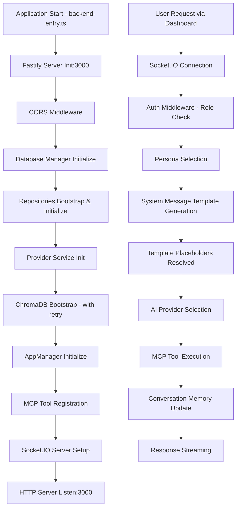

# THE-LAB

An intelligent agentic workflow platform designed for building collaborative Apps through multi-agent reasoning and specialized persona-based task delegation.

## Overview

THE-LAB leverages a team of specialized AI personas (Architect, Code, Debug, QA, etc.) working in concert to deliver high-quality software outcomes. The **Lab Assistant** meets you in the **Laboratory** (full-screen) or the **Sidecar** while you work in apps; personas use MCP tools for implementation, integrations, and validation in one shell.

## Architecture

### Core Components

- **Frontend**: Vue.js 3 + PrimeVue with real-time chat capabilities
- **Backend**: Node.js + Fastify server with MCP tool execution
- **Memory**: ChromaDB vector database for conversation context persistence
- **AI Providers**: Ollama, OpenAI-compatible endpoints (e.g. LM Studio), and OpenAI cloud via Settings
- **Identity**: Platform users in main SQLite; session cookie + JWT; optional SSO (Google, GitHub, Microsoft Entra) via **Settings → Auth Providers**

### System Flow



## Key Features

### Multi-Persona Reasoning
- Specialized personas for different development roles (Architect, Code, Debug, QA)
- Dynamic persona selection based on task requirements
- Collaborative reasoning and task delegation

### Real-Time Communication
- Socket.IO WebSocket support for real-time collaboration
- Live chat interface with streaming responses
- Persistent conversation context via ChromaDB

### Lab Assistant: Laboratory & Sidecar (dual-view shell)

The **Lab Assistant** is THE-LAB’s AI teammate (personas, MCP tools, same chat sessions). It appears in **two places** so you can stay in flow on apps or go deep on automation:

| Surface | Where | Best for |
|---------|--------|----------|
| **Laboratory** | Full-screen chat — quick nav **Laboratory** or comment-dots in the brand header | Repo-wide work, file edits, watching **tool/MCP activity** in the transcript, long sessions |
| **Lab Sidecar** | **Lab Assistant** chip, top-right on the **apps workspace** (catalog + mounted apps) | “In this app / on this screen” help, **UI automation** on visible UI, wiring integrations without leaving the app |

Both use the **same Dexie chat sessions** (switch tabs in the Sidecar; create/delete sessions in Laboratory). Sidecar sends add **view context** — catalog-only, single mounted app, or split tabs — so system instructions and automation target the right surface. Open **Laboratory** from the Sidecar header when you need the full transcript and attachments.

- Focus **Laboratory** → apps workspace blurs; focus **apps** (catalog or app area) → Laboratory blurs. Both stay mounted in the DOM (CSS blur/opacity only).
- **Messages** (quick nav) is separate: human DMs on `/lab-comms`, not Lab Assistant chat.

Terminology: [docs/platform/lab-shell-terminology.md](docs/platform/lab-shell-terminology.md) · Sidecar guide: [docs/platform/lab-sidecar.md](docs/platform/lab-sidecar.md) (replaces the old chat preview peek)

### Platform apps, catalog apps & integration

THE-LAB ships two layers of **Apps** in one registry; **lab app integrations** give them the **same integration model**:

| Layer | Examples | Role |
|-------|----------|------|
| **Platform apps** | CRM, Task List, Help Desk, Forms Builder, Chart Builder, Workflow Studio, Approvals & Policies, Financial Ledger, App Builder (`app-lab-*`, core product) | Day-to-day product UX plus **integration services** on the platform hub (**port 3000**) |
| **Catalog apps** | Portfolio apps (inventory, OKR, games, vertical tools, `app-*` ids) | Tagged on the **apps home** grid; hybrid/server apps expose the same **manifest + connector** pattern |

**How they connect**

- **Host** apps declare slots (`accepts`, `integrationSurfaces`) in the registry **integration manifest**.
- **Provider** apps (usually Forms Builder / Chart Builder) hold generated **stubs**; **bindings** in main SQLite map host slot → provider asset.
- **Consumers** call connector routes or use `LabIntegrationSurface` at runtime; **Workflow Studio** and other hosts call the same services via `integration_create` / lookups.
- **Domain events** from platform and catalog apps feed rules and workflows on the shared bus.

**New apps** — scaffolded via **App Builder** or `npm run generate:app` — can register manifests, publish integration services, and be wired by the Lab Assistant (Sidecar or Laboratory) using the same MCP playbook as first-party hosts. Authoring guide: [docs/platform/lab-integration-host-authoring.md](docs/platform/lab-integration-host-authoring.md).

User-facing wiring: [docs/platform/lab-app-integrations.md](docs/platform/lab-app-integrations.md)

### MCP Tool Integration
- File system operations (create, read, update, delete)
- Database query execution (SQLite)
- Web fetching and querying capabilities
- Code search and semantic analysis
- Terminal command execution

### Platform theming
- One **platform-wide theme** for dashboard, Laboratory, Settings, and all mounted apps
- **20 built-in presets** (10 dark / 10 light); admins tune under **Settings → Themes** with live draft + Save
- **Custom themes** via duplicate-to-custom; Tailwind palette pickers store resolved CSS colors
- See [docs/platform/platform-theming.md](docs/platform/platform-theming.md) · presets in `src/shared/theme/presets/`

### Team messaging
- **Messages** in the dashboard quick nav — human DMs via Socket.IO `/lab-comms` (separate from Laboratory / Sidecar chat)
- Persisted in main SQLite; presence (green/yellow/red); unread on nav + tabs (active tab auto mark-read)
- Closeable conversation tabs; team roster from `GET /api/platform/users`; OIDC-friendly display names
- See [docs/platform/lab-messaging.md](docs/platform/lab-messaging.md)

### Lab virtual bank (Quarks) & catalog games
- **Quarks** — platform play-money (not real currency); opening balance, daily UTC allotment, wallet in quick nav and many game headers ([docs/platform/lab-virtual-bank.md](docs/platform/lab-virtual-bank.md))
- **Game platform kit** — shared matches, invites, turn-based UI (`GameBoardRow`, `PlayerTurnsPanel`), and optional **virtual bank settlements** when matches finish
- **Play vs Lab Assistant** — turn-based catalog games (chess, checkers, connect four, battleship, hangman, poker, tic-tac-toe, word tile, blackjack tablemate vs dealer, …) pit the human against the **configured lab LLM** at chosen difficulty (`easy`–`boss`), not a hidden engine or canned opponent script. Lobby copy: **Play vs Lab Assistant**; PvP via **Invite a friend**. User overview: About → **Games & Quarks**; kit: [docs/platform/lab-games.md](docs/platform/lab-games.md) · per-app [docs/apps/](docs/apps/)

### Lab app integrations
- **Manifest-driven plugins** — bindings in `lab_integration_bindings` replace hard-coded form keys; shared runtime via `LabIntegrationSurface` and discovery on the integration hub (**3000**)
- **AI-first wiring** — ask in **Laboratory** or **Lab Sidecar** to list manifests/bindings, provision Forms/Chart stubs, and upsert bindings (`lab_integrations_*` MCP tools)
- **Launch promotion** — enabled bindings can add provider apps (e.g. Chart Builder) to a host’s `dependencies` for correct startup order
- **Warm-up** — hybrid/server connector backends pre-start on main backend boot (opt out: `LAB_APP_SERVER_WARMUP=0`); see [lab stack](docs/operations/lab-stack.md#app-server-warm-up)
- User guide: [docs/platform/lab-app-integrations.md](docs/platform/lab-app-integrations.md) · host authoring: [docs/platform/lab-integration-host-authoring.md](docs/platform/lab-integration-host-authoring.md) · roadmap: [docs/roadmap.md](docs/roadmap.md)

### Platform automation (domain events, rules, workflows)
- **Lab domain event bus** — typed events from catalog and platform apps; feeds notifications and automation ([docs/platform/lab-domain-events.md](docs/platform/lab-domain-events.md))
- **Rules engine** — user/global rules on events; optional legacy bus evaluation via `LAB_BUS_RULES_EVALUATION=1` ([docs/platform/lab-rules-engine.md](docs/platform/lab-rules-engine.md))
- **Workflow Studio** — event-triggered graphs with conditions, connector lookups, branches, and steps such as notify, Messages DM, `publish_event`, **`integration_create` / `integration_update`**, and **`http_request`** (payload/body mapping); MCP server for workflow CRUD and runs ([docs/platform/lab-workflow-studio.md](docs/platform/lab-workflow-studio.md))
- **Approvals & policies** and **Financial Ledger** — platform services on **3000**, consumed by CRM and catalog hosts via integration slots ([docs/platform/lab-approvals.md](docs/platform/lab-approvals.md), [docs/platform/lab-financial-ledger.md](docs/platform/lab-financial-ledger.md))
- Architecture overview: [docs/platform/lab-automation-architecture.md](docs/platform/lab-automation-architecture.md)

### Apps — DnD and theming
- **Drag-and-drop:** all `src/apps/**` DnD must use **`@vue-dnd-kit/core`** (see `dnd-examples` app and [docs/platform/platform-theming.md](docs/platform/platform-theming.md) § Drag and drop).
- **Theming:** every app screen (lobby, game views, modals) honors platform **`lab-*`** tokens — [docs/platform/platform-theming.md](docs/platform/platform-theming.md).

### App Management
- Support for three app types: Browser, Server, and Hybrid
- Dynamic port allocation (4000-4999 range)
- Isolated SQLite databases per app instance
- Dependency resolution with cycle detection
- Role-based access control (Owner, Admin, Member, Viewer)
- Hybrid/server apps use **app port** APIs (`serverUrl`); platform host stays on port **3000**

### Security & production profile
- Authenticated HTTP and Socket.IO for dashboard and app launch/teardown
- **Production profile** (`LAB_PRODUCTION_PROFILE=1`) tightens MCP/file tooling and app-scoped permissions
- OIDC IdPs are configured in the UI only — see [docs/auth/oidc-jit-phase1.md](docs/auth/oidc-jit-phase1.md) (not `.env` secrets for IdP registry)

### Database Architecture
- Main application database (better-sqlite3) with WAL mode
- Per-app isolated databases for server-side applications
- Repository pattern for domain-specific data access
- Bootstrap and initialize sequence for consistent state

## Technology Stack

| Layer | Technology |
|-------|------------|
| Frontend Framework | Vue.js 3 + PrimeVue |
| Backend Runtime | Node.js + TypeScript |
| Web Framework | Fastify |
| Real-Time | Socket.IO |
| Database | SQLite (better-sqlite3) + ChromaDB |
| AI Integration | OpenAI / Ollama |
| Tool Protocol | Model Context Protocol (MCP) |

## Environment Variables

| Variable | Default | Description |
|----------|---------|-------------|
| `DATABASE_PATH` | `db/the_lab.db` | Main SQLite path (CI smoke uses `db/the_lab_smoke.db`) |
| `BACKEND_URL` | `http://localhost:3000` | Override backend URL for frontend |
| `VITE_LOGGING_ENABLED` | `1` | Enable/disable file logging (0 or 1) |
| `LOG_OUTPUT_PATH` | N/A | Path for log files when logging enabled |
| `LAB_PRODUCTION_PROFILE` | `0` | `1` enables production MCP/file policy enforcement |
| `LAB_APP_SERVER_WARMUP` | `1` | `0` skips hybrid/server connector warm-up on backend start |
| `LAB_BUS_RULES_EVALUATION` | `0` | `1` runs legacy global rules pass on each domain event (workflows always run after) |
| `THE_LAB_CHROMA_BIN` | auto | Optional path to Python `chroma` CLI (see [docs/operations/lab-stack.md](docs/operations/lab-stack.md)) |

See [.env.example](.env.example) for the full list.

## Development Commands

```bash
# Full startup (sync apps, ChromaDB + Vite + backend)
npm run dev

# Lab stack (Chroma + backend + Vite) — used by Playwright smoke
npm run lab:start -- --wait-ready --detach
npm run lab:stop

# Backend only
npm run back-end

# Frontend only (Vite)
npm run front-end

# Build for production
npm run build

# Pre-PR / CI v1 gate — run and verify before opening any pull request
# (lint, type-check, verify:test-tiers, test:ci, build — same steps as Azure minus smoke)
npm run test:pipeline

# Full lab regression (356 suites — run before risky merges)
npm run test:regression

# Platform-only shortcuts (not the CI gate)
npm run lint:ci && npm run type-check:ci

# Playwright smoke (stack must be up, or use lab:start first)
npm run test:smoke
```

## Documentation

| Topic | Doc |
|-------|-----|
| **Initial local setup** | [docs/setup/readme.md](docs/setup/readme.md) |
| CI contract (`master`; smoke local/manual) | [docs/ci/ci-v1-contract.md](docs/ci/ci-v1-contract.md) |
| Lab stack / Chroma | [docs/operations/lab-stack.md](docs/operations/lab-stack.md) |
| OIDC / Auth Providers | [docs/auth/oidc-jit-phase1.md](docs/auth/oidc-jit-phase1.md) |
| Platform theming (presets, admin UI) | [docs/platform/platform-theming.md](docs/platform/platform-theming.md) |
| Team messaging (DMs, presence) | [docs/platform/lab-messaging.md](docs/platform/lab-messaging.md) |
| Lab shell (Laboratory vs Sidecar) | [docs/platform/lab-shell-terminology.md](docs/platform/lab-shell-terminology.md) · [lab-sidecar.md](docs/platform/lab-sidecar.md) |
| Lab app integrations (bindings, stubs) | [docs/platform/lab-app-integrations.md](docs/platform/lab-app-integrations.md) |
| Lab virtual bank (Quarks) | [docs/platform/lab-virtual-bank.md](docs/platform/lab-virtual-bank.md) |
| Catalog games (e.g. Blackjack) | [docs/apps/blackjack.md](docs/apps/blackjack.md) · [docs/apps/](docs/apps/) |
| Workflow Studio & workflow MCP | [docs/platform/lab-workflow-studio.md](docs/platform/lab-workflow-studio.md) |
| Domain events & rules engine | [docs/platform/lab-domain-events.md](docs/platform/lab-domain-events.md) · [lab-rules-engine.md](docs/platform/lab-rules-engine.md) |
| App system instructions (agents) | [docs/platform/app-system-instructions.md](docs/platform/app-system-instructions.md) |
| Product roadmap | [docs/roadmap.md](docs/roadmap.md) |
| Operator / degraded Chroma | [docs/operations/operator-runbook.md](docs/operations/operator-runbook.md) |
| Agent & architecture deep dive | [AGENTS.md](AGENTS.md) |

## Directory Structure

```
src/
├── App.vue                              # Root Vue component
├── backend-entry.ts                     # Application entry point
├── main.ts                              # Vue application bootstrap
├── apps/                                # Apps directory
│   └── {app-id}/                       # Individual applications
├── backend/                             # Backend server code
│   ├── ai/                              # AI provider integration
│   │   ├── providers/                   # OpenAI/Ollama adapters
│   │   └── provider-service.ts          # Provider orchestration
│   ├── chroma/                          # ChromaDB integration
│   ├── db/                              # SQLite layer
│   │   ├── Auth/                        # Authentication repository
│   │   ├── Apps/                        # App registry + integration manifests
│   │   ├── LabIntegrations/             # Bindings, CRM/catalog seed packs
│   │   ├── LabWorkflows/                # Workflow definitions, runs, schedules
│   │   ├── LabEvents/                   # Domain event catalog
│   │   ├── LabRules/                    # Rules library
│   │   ├── Persona/                     # Persona repository
│   │   └── ...                          # Other repositories
│   ├── lab-integrations/                # Hub, discovery, stub provisioners
│   ├── mcp/                             # MCP tool registry
│   │   ├── mcp-servers/                 # In-process + workflow/integrations servers
│   │   └── tools/                       # Individual MCP tools
│   ├── middleware/                      # Auth middleware
│   ├── routes/                          # API endpoints
│   └── server.ts                        # Main Fastify server
├── dashboard/                           # Dashboard UI components
├── shared/                              # Shared types, integration runtime, templates
│   ├── integration/                     # LabIntegrationSurface, host chrome
│   └── lab-integrations/                # Manifests, discovery contracts
└── tests/                               # Jest + Playwright smoke under tests/e2e
```

## Role-Based Access Control

| Role | Launch | Teardown | Update | Delete | Manage Users | View Logs |
|------|--------|----------|--------|--------|--------------|-----------|
| owner | ✓ | ✓ | ✓ | ✓ | ✓ | ✓ |
| admin | ✓ | ✓ | ✓ | ✓ | ✓ | ✓ |
| member | ✓ | ✓ | ✗ | ✗ | ✗ | ✗ |
| viewer | ✗ | ✗ | ✗ | ✗ | ✗ | ✗ |

## Available MCP Tools

| Tool ID | Name | Description |
|---------|------|-------------|
| `create_directory` | Create Directory | Creates a directory or full directory structure on the filesystem |
| `remove_directory` | Remove Directory | Removes a directory from the filesystem |
| `context_7` | Context7 Documentation Query | Provides version-specific documentation and code examples from source |
| `app_management` | App Management Tool | Manages apps through operations: create_app, get_app, get_apps, update_app, delete_app |
| `create_file` | Create File | Creates a new file on the filesystem with optional content |
| `list_files` | List Files | Lists files and directories within a specified filesystem path |
| `read_file` | Read File | Reads the content of a file from the filesystem |
| `remove_file` | Remove File | Removes a file or directory from the filesystem |
| `update_file` | Update File | Applies structured diff patches to an existing file |
| `todo_list` | Todo List | Manages todo lists and their items |
| `web_fetch` | Web Fetch | Fetches raw contents of a URL over HTTP or HTTPS |
| `web_query` | Web Query | Performs web search for a single query and returns relevant results |
| `persona_manager` | Persona Manager | Manages persona-based chat sessions and enables persona/todo list task-based delegation |
| `run_terminal_command` | Run Terminal Command | Execute terminal commands on the system and returns their output |
| `search_repository` | Search Repository | Pattern-based search (GREP style) across files in the project repository |
| `documentor` | Documentor | Manages documentation related files for save and update operations |
| `followup_tool` | Followup | Prompt user with follow-up questions or multiple choice options |
| `ui_automation` | UI Automation | Interact with THE-LAB browser UI (element discovery with DOM Context, clicks) |

**Lab integrations & workflows (Workflow Studio)** — additional MCP tools include `lab_integrations_*` (manifest, bindings, stub provision, launch deps) and `lab_workflow_*` (definitions, runs, schedules). Persona allowlists and full IDs live in the database and [docs/platform/lab-integration-host-authoring.md](docs/platform/lab-integration-host-authoring.md).

## Author

**Michael Ballhaus** (Ambient Technologies Group) — enterprise platform engineer; THE-LAB is a portfolio capstone (multi-agent orchestration, MCP, providers, KB RAG).

**Contact:** [ambienttechnologygroup@gmail.com](mailto:ambienttechnologygroup@gmail.com) — commercial licensing and security reports.

## License

This project is licensed under the **GNU Affero General Public License v3.0** — see [`LICENSE`](LICENSE).

**Commercial use** (proprietary deployment without AGPL obligations) requires a separate license — see [`COMMERCIAL.md`](COMMERCIAL.md).

**Security:** report vulnerabilities per [`SECURITY.md`](SECURITY.md). **Contributing:** [`CONTRIBUTING.md`](CONTRIBUTING.md).
