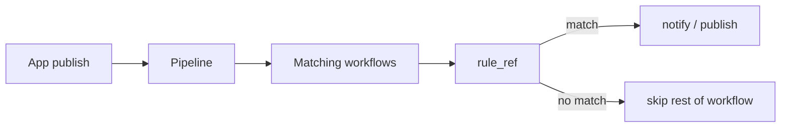

# Lab automation architecture (bus, rules, workflows)

Platform automation on **main backend port 3000**. There is **no separate event-bus app** — publish, persistence, notifications, and orchestration run in-process on the same pipeline.

## Layers

| Layer | Role | Subscribes to the bus? |
|-------|------|-------------------------|
| **Apps** | Publish [domain events](lab-domain-events.md) (facts). | N/A (publishers) |
| **Rules** | Reusable **match libraries** (triggers + conditions). | **No** (by default) — invoked by workflows or dry-run |
| **Workflows** | **Subscriptions** + ordered **steps** (actions). | **Yes** — enabled workflows whose trigger matches the envelope |

The **event catalog** (Settings / Rules app) is documentation and picker metadata. **Runtime routing** is driven by **workflow records** (and optional legacy bus-wide rules when `LAB_BUS_RULES_EVALUATION=1`).

## Publish pipeline

On each successful publish (HTTP or in-process):

1. Persist event (no inbox rows at publish time)
2. **Rules** — only if `LAB_BUS_RULES_EVALUATION=1` or caller passes `runRulesEvaluation: true` (legacy; may emit `platform-rules.evaluation.completed`)
3. **Workflows** — every enabled workflow whose `definition.trigger.eventType` (and optional conditions) matches the envelope; steps run in order (notify steps write inbox rows + socket fan-out)

Derived events from workflow `publish_event` steps follow the same pipeline unless the caller opts out of rules evaluation for that inner publish.

## Rules as library nodes

- Rules are stored in SQLite and edited in **Rules Engine** (native UI).
- **Compatible event types** on a rule describe when it *can* be referenced; they do not register a global listener.
- Workflows reference rules with a **`rule_ref`** step (`ruleId`). At runtime the platform evaluates that rule against the **current** envelope (same matching as dry-run). If the rule does not match, **remaining steps in that workflow are skipped** for this event.
- Optional: chain `rule_ref` → `notify_users` / `notify_payload_user` / `publish_event`.

Use **`@me`** in rule conditions for assignee-style automation without per-user copies — see [lab-rules-engine.md](lab-rules-engine.md).

## Workflow-centric orchestration (target)

**v1** shipped: linear `trigger` + `steps[]` in JSON (Settings + structured editor). **v2** (rm-60+): visual graph (event node → rule library ref → action nodes); same runtime concepts.

## Scopes

| Scope | Rules | Workflows |
|-------|-------|-----------|
| **global** | Admin-managed; hidden from members in list | Same |
| **user** | Owner-only; user rules also require `actorUserId === ownerUserId` at match time | User workflows same actor constraint |

For **assignee-driven** automation (Alice assigns Bob), prefer **global** workflows with `notify_payload_user` on `assigneeId` and global `@me` on assignee conditions — not user-scoped workflows owned by Bob.

## Related docs

- [Lab domain events](lab-domain-events.md)
- [Rules engine](lab-rules-engine.md)
- [Workflow Studio](lab-workflow-studio.md)
- Plan: [plans/rm-60-workflow-studio/architecture.md](../../plans/rm-60-workflow-studio/architecture.md)
