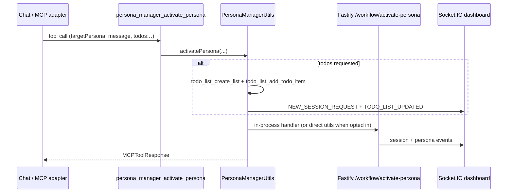

# Persona delegation contract (SOT sketch — 1.20)

**Status:** Field alignment reference for in-process `PersonaManagerUtils` (default path).

## Activate flow (high level)

## Core fields (activate)

| Field | MCP manifest | PersonaManagerUtils | Notes |
|-------|--------------|---------------------|-------|
| `targetPersona` | required | required | Chat persona name |
| `messageToAgent` / user message | required | maps to session placeholder | |
| `originatingSessionId` | required | required | Parent session |
| `todoListId` / `todoListName` | optional | optional | Triggers split todo tools |
| `todoItemId` / `todoItem` / `todoItemData` | optional | maps to `itemId` / `item` / `itemData` for `todo_list_add_todo_item` | |

## Response flow

See `persona_manager_response_persona` and `/workflow/response-persona` — must use the same session/chat IDs returned from activate (**1.21**).

## Related

- [mcp-internal-review.md](../../plans/the-lab-optimization/mcp-internal-review.md)
- `src/backend/mcp/mcp-servers/persona/utils/persona-manager-utils.ts`
