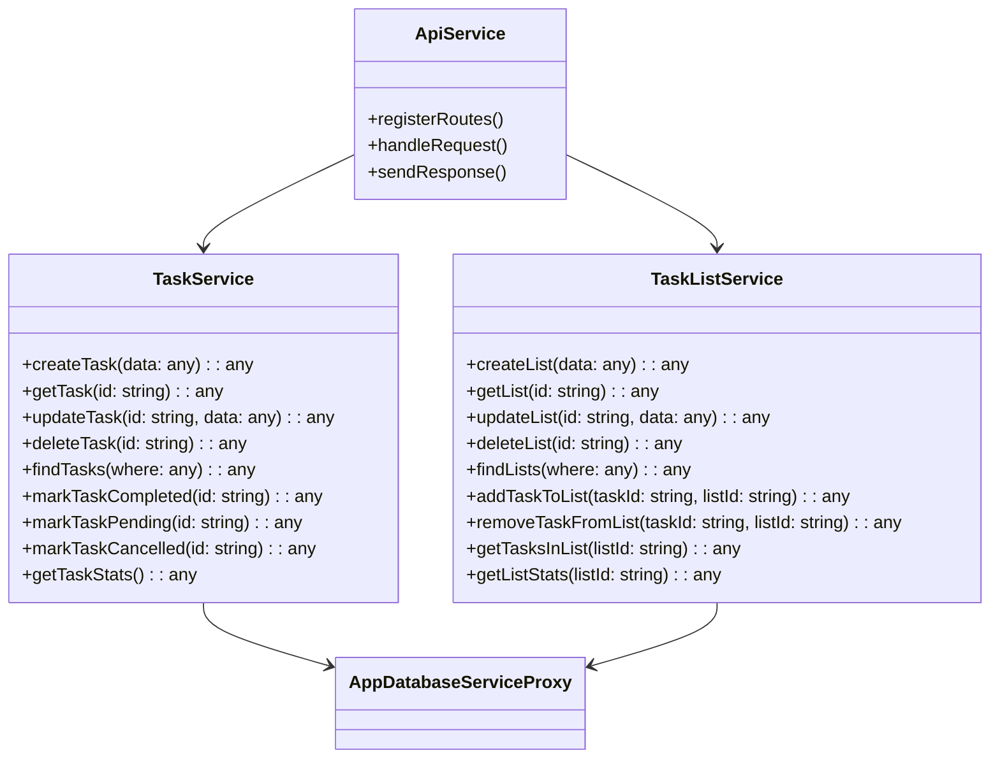

# Task List App - Development Plan

## Overview
This document outlines the development plan for building a simple task management system in the task-list application.

---

## Phase 1: Shared Types and Utilities (COMPLETED)

### Status: ✅ Complete

**Location**: ./src/apps/lab-tasklist/shared/

#### Types (shared/types/)
- task.types.ts - Core type definitions
  - TaskStatus enum (PENDING, IN_PROGRESS, COMPLETED, CANCELLED)
  - TaskPriority enum (LOW, MEDIUM, HIGH, URGENT)
  - Task interface - main task data structure
  - TaskList interface - collection of tasks

---

## Phase 2: Database Schema (COMPLETED)

### Status: ✅ Complete

**Location**: ./src/apps/lab-tasklist/db/

### Database Implementation
- app-db-service.ts - Database service proxy for all CRUD operations
- the_lab.db - SQLite database file (initialized)

### Created Tables

#### 1. tasks Table
- id (TEXT, PRIMARY KEY) - Unique task identifier
- title (TEXT, NOT NULL) - Task title
- description (TEXT) - Task description
- status (TEXT, NOT NULL) - Task status (pending, in_progress, completed, cancelled)
- priority (TEXT, NOT NULL) - Task priority (low, medium, high, urgent)
- due_date (TEXT) - Task due date (ISO 8601 format)
- assignee_id (TEXT) - Reference to user who owns the task
- tags (TEXT) - JSON array of tags
- completed_at (TEXT) - Timestamp when task was completed
- created_at (TEXT) - Creation timestamp
- updated_at (TEXT) - Last update timestamp

#### 2. task_lists Table
- id (TEXT, PRIMARY KEY) - Unique list identifier
- name (TEXT, NOT NULL) - List name
- description (TEXT) - List description
- created_at (TEXT) - Creation timestamp
- updated_at (TEXT) - Last update timestamp

#### 3. task_list_tasks Table (Many-to-Many Join)
- task_list_id (TEXT, NOT NULL) - Reference to task_lists table
- task_id (TEXT, NOT NULL) - Reference to tasks table
- created_at (TEXT) - When task was added to list

---

## Phase 3: Back-End Services (COMPLETE)

### Status: ✅ Complete

**Location**: ./src/apps/lab-tasklist/back-end/

### Implemented Components

#### 1. Database Service ✅
- app-db-service.ts - Database service proxy for all CRUD operations
  - Wraps AppDatabaseService from backend
  - Provides unified interface for all database operations
  - Singleton pattern implementation

#### 2. Task List Service ✅
- task-list-service.ts - Task list CRUD operations (COMPLETE)
  - createList() - Create new task list
  - getList() - Get single task list with tasks
  - updateList() - Update task list
  - deleteList() - Delete task list
  - findLists() - Find task lists with filtering and pagination
  - addTaskToList() - Add task to list
  - removeTaskFromList() - Remove task from list
  - getTasksInList() - Get all tasks in a list
  - getListStats() - Get list statistics by status
  - mapListFromRow() - Map database row to TaskList
  - mapTaskFromRow() - Map database row to Task

#### 3. Task Service ✅
- task-service.ts - FULLY IMPLEMENTED
  - Task create/update via Forms Builder submit (connector), not direct REST from UI
  - getTask() - Get single task by ID
  - updateTask() - Update task with all fields
  - deleteTask() - Delete tasks
  - findTasks() - Advanced filtering, sorting, pagination
  - markTaskCompleted/Pending/Cancelled - Status management
  - getTaskStats() - Comprehensive statistics
  - Input validation and date handling
  - Pagination with total count calculation
#### 4. API Endpoints ✅
- appRoutes.ts - FULLY IMPLEMENTED in back-end/utils/
  - GET /api/tasks - List all tasks (with filters, pagination, sorting)
  - GET /api/tasks/:id - Get single task
  - POST /api/tasks - Create new task
  - PUT /api/tasks/:id - Update task
  - DELETE /api/tasks/:id - Delete task
  - GET /api/task-lists - List all task lists
  - GET /api/task-lists/:id - Get tasks in a list
  - POST /api/task-lists - Create new task list
  - PUT /api/task-lists/:id - Update task list
  - DELETE /api/task-lists/:id - Delete task list
  - **Implementation Pattern**:
    - Route handlers in separate file for clean architecture

#### 5. Route Registration ✅
- server.ts - **COMPLETED**
  - ✅ Added: `import { registerTaskRoutes, registerTaskListRoutes } from './utils/appRoutes'`
  - ✅ Added: `registerTaskRoutes(server)` - Register task CRUD endpoints
  - ✅ Added: `registerTaskListRoutes(server)` - Register task list CRUD endpoints
  - **Current Status**: All API endpoints registered and accessible
  - **Implementation**: appRoutes.ts successfully imported and registered in server.ts
  - **Impact**: All API endpoints are now fully functional
    - TypeScript compilation: ✅ PASS (0 errors)

---

## Phase 4: Front-End Components - Shared Types (COMPLETED)

### Status: ✅ Complete

**Location**: ./src/apps/lab-tasklist/front-end/

### Shared Types
- task.types.ts - Comprehensive TypeScript definitions
  - TaskStatus enum (pending, in_progress, completed, cancelled)
  - TaskPriority enum (low, medium, high, urgent)
  - Task, TaskList, TaskFilter, TaskSort interfaces
  - TaskCreateInput, TaskUpdateInput interfaces
  - PaginationInfo, TaskStats interfaces

### Front-End Composables ✅

#### 1. useTasks.ts
**Location**: `src/apps/task-list/front-end/composables/useTasks.ts`
- Reactive state for tasks, loading, error, filters, sort, pagination
- Filtering logic (status, priority, search query)
- Sorting and pagination computed properties
- API functions: fetchTasks, deleteTask, getTaskStats (create/update via Forms Builder in UI)
- Computed: totalTasks, completedTasks
- Getters: getFilteredTasks, getTaskById

#### 2. useTaskLists.ts
**Location**: `src/apps/task-list/front-end/composables/useTaskLists.ts`
- Reactive state for taskLists, loading, error, filters
- Filtering logic (search query)
- API functions: fetchTaskLists, deleteTaskList (create/update via Forms Builder in UI)
- Extended functions: getTaskListWithTasks, getTaskListStats
- Computed: totalLists, completedLists

#### 3. useTaskFilters.ts
**Location**: `src/apps/task-list/front-end/composables/useTaskFilters.ts`
- State for: statusFilter, priorityFilter, searchQuery, assigneeFilter, dateRangeStart/End
- Computed filters object matching backend API format
- Filter actions: setStatusFilter, setPriorityFilter, setSearchQuery, etc.
- Utility functions: clearAllFilters, resetFilters
- Computed: hasActiveFilters, clearFilters

---

### Architecture Diagram
- appRoutes.ts - FULLY IMPLEMENTED in back-end/utils/
  - GET /api/tasks - List all tasks (with filters, pagination, sorting)
  - GET /api/tasks/:id - Get single task
  - POST /api/tasks - Create new task
  - PUT /api/tasks/:id - Update task
  - DELETE /api/tasks/:id - Delete task
  - GET /api/task-lists - List all task lists
  - GET /api/task-lists/:id - Get tasks in a list
  - POST /api/task-lists - Create new task list
  - PUT /api/task-lists/:id - Update task list
  - DELETE /api/task-lists/:id - Delete task list
  - **Implementation Pattern**:
    - Route handlers in separate file for clean architecture

#### 5. Route Registration ✅
- server.ts - **COMPLETED**
  - ✅ Added: `import { registerTaskRoutes, registerTaskListRoutes } from './utils/appRoutes'`
  - ✅ Added: `registerTaskRoutes(server)` - Register task CRUD endpoints
  - ✅ Added: `registerTaskListRoutes(server)` - Register task list CRUD endpoints
  - **Current Status**: All API endpoints registered and accessible
  - **Implementation**: appRoutes.ts successfully imported and registered in server.ts
  - **Impact**: All API endpoints are now fully functional
    - TypeScript compilation: ✅ PASS (0 errors)

### Architecture Diagram

mermaid
graph TB
    subgraph "API Layer"
        API[Fastify API Endpoints]
    end
    
    subgraph "Task Services"
        TaskService[Task Service - COMPLETE]
        TaskListService[Task List Service - COMPLETE]
    end
    
    subgraph "Database"
        Tasks[(tasks table)]
        Lists[(task_lists table)]
        Join[(task_list_tasks join table)]
    end
    
    API --> TaskService
    API --> TaskListService
    TaskService --> AppDatabaseServiceProxy
    TaskListService --> AppDatabaseServiceProxy
```

### Component Architecture



### Current Server Status
- server.ts - Basic Fastify server with Socket.IO
- Port: 3005
- WebSocket connection established
- Task-related API routes implemented and registered
- TypeScript compilation: ✅ PASS (0 errors)
- Linting: ✅ PASS (warnings only, intentional for Fastify patterns)
- **Route Registration**: ✅ COMPLETE

---

## Phase 4: Front-End Components (PENDING)

### Status: 🚧 Pending

**Location**: ./src/apps/lab-tasklist/front-end/

### Required Components

#### 1. Main Components
- TaskList.vue - Main task list container
- TaskItem.vue - Individual task display
- FormsBuilderFormPanel.vue - Create/edit task and task-list (FormMounter + Forms Builder)
- TaskFilters.vue - Filter and search controls
- TaskStats.vue - Statistics dashboard

#### 2. Composables ✅
- useTasks.ts - Task state management and API calls
- useTaskLists.ts - Task list state management
- useTaskFilters.ts - Filter logic and state

#### 3. Types
- Use shared types: `./src/apps/lab-tasklist/shared/types/index`

---

## Key Features

### Core Functionality
- Task creation, reading, updating, deletion (CRUD)
- Task status management (pending -> in_progress -> completed)
- Priority levels and sorting
- Task filtering and search
- Task lists organization
- Due date tracking
- Task statistics and analytics

### Advanced Features (Future)
- User assignment and notifications
- Recurring tasks
- Task dependencies
- Drag-and-drop reordering
- Export/import functionality
- Real-time collaboration

---

## Technical Stack

- Frontend: Vue 3 + TypeScript + PrimeVue
- Backend: Node.js + Fastify
- Database: SQLite (via AppDatabaseService)
- Shared: TypeScript interfaces and utilities

---

*Last Updated: 2026-5-27*
*Current Implementation Status: Phase 4 COMPLETE - Ready for Phase 5*